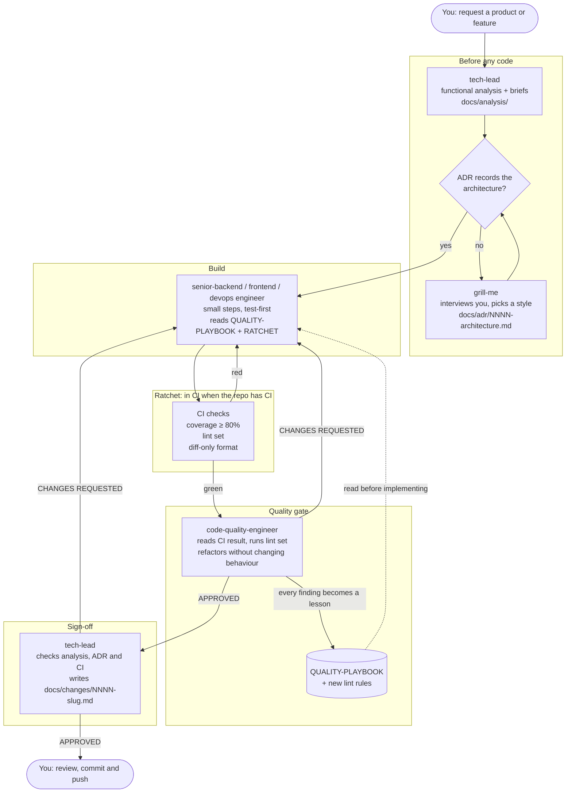

# AI harness template

A team of Claude Code skills that works like an engineering team, plus the shared standards they read.

## How the team works



Every change goes engineer → code-quality-engineer → tech-lead → you. You own git history: the skills never commit or push.

## What's inside

- `skills/` holds the roles: `tech-lead`, `senior-backend-engineer`, `senior-frontend-engineer`, `senior-devops-engineer`, `code-quality-engineer` and `grill-me` (picks the architecture with you).
- `shared/` holds the standards every role reads: architecture, principles, design patterns, data structures, system design, the quality playbook and the post-push ratchet rules.

Links between files are relative, so the repository works wherever you clone it.

## Install

You need [Claude Code](https://claude.com/claude-code) and git.

1. Clone the repository anywhere you like:

   ```bash
   git clone https://github.com/Riodev28/ai-harness ~/claude-harness
   ```

2. Link the skills and the shared docs into Claude Code's folder. The skills reach the shared docs through `../../shared/`, so `shared` must sit next to `skills`:

   ```bash
   mkdir -p ~/.claude/skills
   for skill in ~/claude-harness/skills/*/; do
     ln -sfn "$skill" ~/.claude/skills/"$(basename "$skill")"
   done
   ln -sfn ~/claude-harness/shared ~/.claude/shared
   ```

   To use the skills in one project only, link both into that project's `.claude/` instead.

3. Restart Claude Code, then check that the six skills appear.

## Use

- Ask for a feature and invoke the `tech-lead` skill first. It writes the functional analysis and briefs the engineers.
- With no architecture decision yet, the engineers invoke `grill-me`, which interviews you and records an ADR.
- You can also run a skill directly, for example `/code-quality-engineer`.

## Update

```bash
cd ~/claude-harness && git pull
```

Symlinked skills pick up the changes.

## House rules

- You own git history. The skills may run read-only git, and never commit or push for you.
- After each push, the rules in `shared/RATCHET.md` apply: at least 80% coverage, linter rules written by the code-quality-engineer, and formatting only the diff. If the repository has CI, put them in CI.
